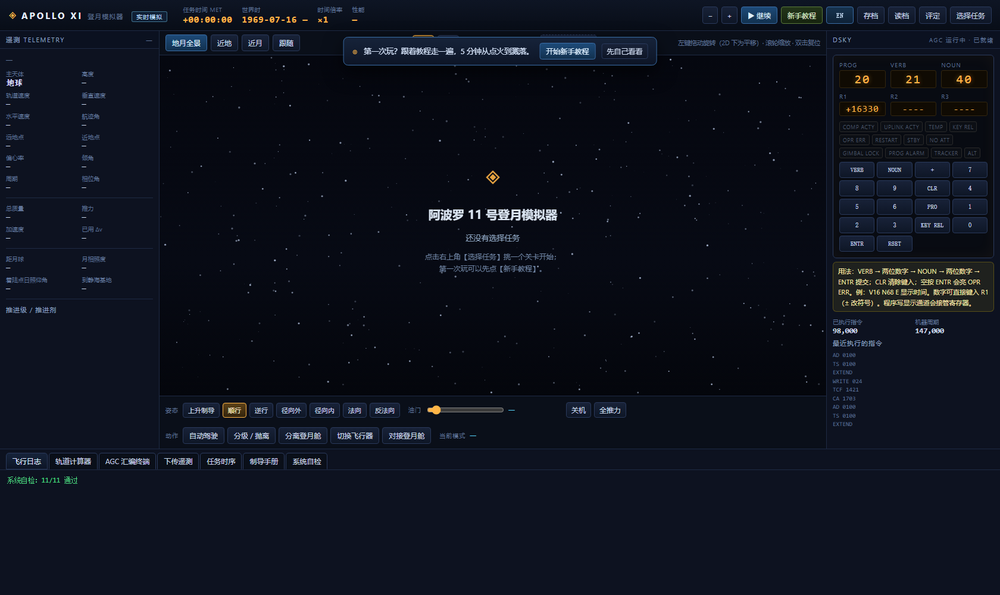
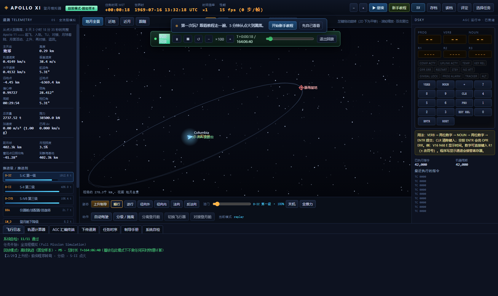

# 阿波罗 11 号登月模拟器 · Apollo 11 Lunar Landing Simulator

**简体中文** | [English](#english-document)

<p align="center">
  
  
</p>

一个**从零手写的阿波罗 11 号全流程模拟器**：从土星五号点火起飞，到地月转移、月球轨道插入、
登月舱分离与动力下降着陆、月面上升、环月交会对接、返回地球与溅落 —— 全部飞行动力学都是
**真实物理实时积分**（RK4 + 地球 J2 + 月球间接项/月球 J2 + 太阳摄动 + Meeus 月球历表 + IAU 月球自转），
并内置一台**可编程的阿波罗制导计算机（AGC Block II）复刻**与它的 DSKY 面板。

> 纯离线、零外部依赖：没有 CDN、没有联网请求、没有第三方前端库。全部代码（约 2 万行）
> 都是本仓库自己的源码，并在 `docs/` 里留下了完整的开发与验证记录。

---

## 一、下载 / 怎么玩

| 方式 | 说明 |
|---|---|
| **① 直接玩（推荐）** | 下载 [`download/Apollo11LunarLanding.exe`](download/Apollo11LunarLanding.exe)（**8.7 MB，Windows 单文件，免安装、免运行库，双击即玩**）。第一次运行会解压到系统临时目录并打开一个应用窗口。 |
| ② 从源码运行 | 只需 **Python 3.8+** 和任意现代浏览器（**零依赖**）：`python run.py` |
| ③ 自己打包成 EXE | `build.bat`（需要 `pip install pyinstaller pywebview`），产物在 `dist/` |
| ④ GitHub Releases | 上传仓库后，把 `download/` 里的 EXE 作为 Release 附件放一份，别人就能从 Releases 页直接下载（正文可直接用 [`RELEASE_NOTES.md`](RELEASE_NOTES.md)）。 |

**最小配置**：Windows 10/11（也可在 macOS/Linux 用源码方式跑），能跑 Chrome/Edge/Firefox 的机器即可。

### 界面怎么用

1. 启动后是**任务选择卡片**：五个任务（01 飞船起飞 / 02 地月轨道转移 / 03 月球对接 /
   04 飞船降落 / 05 全流程模拟）。每张卡片下有【开始任务】（手动飞行）和【自动演示】。
2. **【自动演示】= 离线轨迹回放**：直接播放一条预先用同一套物理生成的完整轨迹（可拖进度、
   可切倍率），适合先看个整体。前四个任务与全流程任务都有回放。
3. **手动飞行**：用底部**飞行控制条**（分级 / 推力 / 姿态 / 制导）操船，左侧遥测面板看数字，
   中央轨道画布支持 3D / 2D 两种投影（2D 是"垂直于轨道面俯视"，拖动 = 平移）。
4. **DSKY 面板**：右侧是 AGC 的显示与键盘 —— 点【VERB】【NOUN】和数字键会立刻上屏
   （例如 `VERB 1 6 NOUN 6 8 ENTR`），面板内也有用法速查卡。
5. 第一次玩建议点顶栏【新手教程】：内置三套课程（快速上手 12 步 / 导航系统 24 步 /
   五个任务通关 36 步），教程会高亮该点的控件；点【下一步】后指针不用离开按钮，
   也可以直接按回车连跳。

---

## 二、还原到了什么程度（与真实 Apollo 11 对照）

模拟器以真实任务为基准：发射时刻 1969-07-16 13:32 UT、土星五号 SA-506 的质量与推力、
静海基地坐标、任务时序都与史料一致。下表是**离线生成 + 自动验收**的实测值
（验收脚本见 `src/tools/`，报告见 `docs/validation/`）：

| 项目 | 真实 Apollo 11 | 本模拟器（实测） |
|---|---|---|
| 地球停泊轨道 | 183.2 × 185.9 km，i = 32.521° | **181.5 × 187.8 km，i = 32.558°**（闸门 ±5 km / ±0.2°） |
| 地月转移（TLI） | 由 S-IVB 二次点火，飞行约 75.9 h | 全模型求解转移窗口 + 有限动力弧打靶，到达近月点 116 km / 面差 0.003° |
| LOI-1（环月捕获） | 111 × 315 km，Δv ≈ 889 m/s | **111 × 314 km，Δv 863 m/s** |
| LOI-2（环月圆化） | 111 × 117 km，Δv ≈ 59 m/s | **111 × 116 km，Δv 42 m/s** |
| 动力下降着陆 | 静海基地 0.674°N / 23.473°E | **偏差 134 m**（闸门 ≤ 1 km） |
| 月面上升 + 交会对接 | 上升级 APS 点火，CW 接近后刚性对接 | 上升入 111 km 环月轨道，CW 闭环收至约 80 m / 0.2 m·s⁻¹ 后对接 |
| TEI（返回注入） | Δv ≈ 997 m/s | **906 m/s**（燃烧 166 s，耗推进剂 4.90 t） |
| 溅落 | 13.3°N / 169.2°W，全程 195 h 18 min 35 s | 溅落成功（见"已知限制"第 2 条） |

另外这些细节也是按真实行为做的：

- **AGC Block II 复刻**：15 位反码字、36 页固定存储器 + 可擦页切换、EXTEND 扩展指令、
  通道 I/O、中断（RUPT）、键盘锁存、DSKY 显示通道（含 OPR ERR / PROG ALARM 灯）、
  自带汇编器与反汇编器 —— 你可以直接写 AGC 汇编程序驱动 DSKY（见 `src/apollo11/webdata/programs/`）。
- **月球历表**：Meeus 级数（含主要摄动项）+ 月球 IAU 自转与天平动；着陆点光照、月面上升与
  返回窗口都按真实历元算。
- **再入与回收**：以真实再入走廊进入，开伞（主伞 CdA = 1064 m²）、溅落。
- **遥测与告警**：AGC 通道写入、DSKY 按键、程序告警都会下传到左侧"下传遥测"面板。

---

## 三、仓库结构

```
Apollo11LunarLanding/
├── download/              可直接运行的 Windows 单文件 EXE
├── screenshots/           README 用的界面截图
├── src/                   ★ 全部源码
│   ├── run.py             启动入口（浏览器模式零依赖；可选 pywebview 原生窗口）
│   ├── apollo11/          Python 宿主（pywebview 窗口 + 文件桥 + 本地 HTTP 服务）
│   │   └── webdata/       ★ 全部前端源码（HTML / CSS / JS）
│   │       ├── index.html
│   │       ├── css/app.css
│   │       ├── js/00-constants.js … js/12-replay.js（按编号顺序加载，全局 APL 命名空间）
│   │       ├── programs/  AGC 汇编示例
│   │       └── traj/      离线轨迹（每个任务的回放数据 + manifest）
│   ├── assets/            图标等资源
│   ├── tools/             构建、验证与诊断脚本（见下）
│   └── Apollo11LunarLanding.spec  PyInstaller 打包配置
└── docs/                  ★ 文档
    ├── 实现报告-物理修复与轨迹回放.md
    ├── AGENT_HANDOFF/     开发交接文档（架构、约定、物理基准、踩过的坑）
    ├── devlog/            逐日开发日志（含每一轮的实测数据与失败原因）
    ├── validation/        离线生成 + 自动验收的报告
    └── 项目README-完整版.md
```

### 前端模块一览（`src/apollo11/webdata/js/`）

| 文件 | 职责 |
|---|---|
| `00-constants.js` | 所有真实参数（火箭质量/推力/Isp、月球/地球常数、任务时序、着陆点） |
| `01-math.js` | 矢量/四元数、二体传播、Lambert、轨道根数 |
| `02-astro.js` | 太阳与月球历表、月球自转、地面站与着陆点坐标 |
| `03-physics.js` | 引力模型（J2/间接项/太阳）、RK4 步长表、制导律（入轨 VGO、环月 LOI、动力下降、CW 交会、TEI）、有限推力燃烧 |
| `04-agc.js` `05-asm.js` | AGC 复刻（CPU / 通道 / DSKY / 中断）与汇编器 |
| `06-render.js` | 轨道画布（3D 透视 / 2D 轨道面俯视、星球与轨道绘制） |
| `07-app.js` | 主循环、遥测面板、任务卡片、存档、自检 |
| `08-programs.js` | 内置 AGC 示例程序 |
| `09-i18n.js` | 中英双语词条与切换 |
| `10-tutorial.js` | 三套互动教程 |
| `11-demo.js` | 任务脚本（每步的 enter/done 条件）与离线轨迹生成 |
| `12-replay.js` | 离线回放播放器（只插值，不积分） |

### `src/tools/` 里的验证工具（这项目的一部分，欢迎复跑）

> 这些脚本以 **`src/` 为根目录**运行（它们按 `apollo11/webdata` 定位资源），
> 例如：`cd src && node tools/save_replay.js ../.tmp/gen.html M5 .`；
> 单元测试：`cd src && node tools/test_physics_p0.js .`。

| 脚本 | 用途 |
|---|---|
| `test_physics_p0.js` / `test_cw_rendezvous.js` / `test_fixed_loi.js` / `test_lunar_arrival.js` / `test_finite_tli.js` | 单元测试：引力模型、CW 交会、固定目标 LOI、月球到达几何、有限弧 TLI |
| `make_replay_probe.js` + `save_replay.js` | 无头浏览器离线生成轨迹（固定步长、禁用一切演示兜底）+ 提取并验收（闸门：停泊轨道、着陆点、溅落点等） |
| `make_replayaudit_probe.js` | 回放期验收：播放时"不重新积分"、同一时刻状态可重复、拖动/倍速/退出 |
| `make_bughunt_probe.js` | 全面自检：DOM id 齐全性、全按钮点击、五个任务遍历、中英往返、教程完整性、异常收集 |
| `sweep_insert_fast.js` / `test_tei_unit.js` / `dump_tli_pack.js` | 入轨参数扫描 / TEI 单元复现 / TLI 数据包导出（诊断用） |

---

## 四、已知限制（如实说明）

1. **全流程任务（05）的演示轨迹是"演示版"**：地月转移、环月、着陆、月面上升、对接、TEI
   都是真实物理生成的；但**交会段的起手位姿**与**返回滑行段**用了"摆位辅助"
   （把上升级放到指令舱后方 25 km 的标准 CW 起手位；返回弹道由物理自洽的摆位给出），
   否则从真实上升轨道直接做 CW 交会会耗尽上升级推进剂。日志会如实打印这些辅助行。
2. **溅落点未命中真实溅落区**：返回弹道偏陡，溅落点落在南太平洋（真实是 13.3°N / 169.2°W）。
   要修需要把 TEI 的"挑最省油相位"改成"挑入射点命中溅落走廊的相位"。
3. **AGC 的位域做了规范化**：真实 AGC 的 12 位地址与操作码存在 bit 重叠，本项目为支持整页
   1024 字寻址做了规范化，指令语义、EXTEND、分页与通道 I/O 行为一致，但**机器码与真机不二进制兼容**。
4. **星球与飞行器是程序化绘制的示意图**（无贴图资产），不追求视觉照片级。

---

## 五、参考与致谢

本项目的**全部代码都是自行实现的**，但在设计与行为上参考了下列公开资料，特此致谢
（详见 [`CREDITS.md`](CREDITS.md)）：

- **[chrislgarry/apollo-11](https://github.com/chrislgarry/apollo-11)** —— Apollo 11 的 AGC 原始源码
  （指令舱 Comanche055、登月舱 Luminary099）。本项目 AGC 复刻的指令集、程序结构、
  DSKY 行为、通道编号与它对照实现（未复制源码；AGC 源码本身为 NASA 出品、公有领域）。
- **[virtualagc/virtualagc](https://github.com/virtualagc/virtualagc)** —— AGC 模拟器与文档。
  本项目把它作为"真实 AGC 行为"的对照基准（同样是独立实现，未复制代码）。
- **NASA 公开资料**：Apollo 11 Mission Report、Apollo 11 Flight Journal、Saturn V SA-506
  的总体参数（质量、推力、Isp、时序）—— 均为公有领域。
- **Meeus《Astronomical Algorithms》**：月球历表级数与月球自转的实现依据。

---

## 六、许可

本项目以 **MIT 许可证**开源，可自由使用、修改、分发（保留版权声明即可）。
见 [`LICENSE`](LICENSE)。

> 免责声明：本项目是**教育与娱乐用途的模拟器**，与 NASA 或任何航天机构无关，
> 不用于任何实际工程用途。AGC 相关实现的精度不足以、也不应该被用于真实飞行。

---

<a id="english-document"></a>

# Apollo 11 Lunar Landing Simulator

[简体中文](#阿波罗-11-号登月模拟器--apollo-11-lunar-landing-simulator) | **English**

<p align="center">
  
  
</p>

A **from-scratch** Apollo 11 mission simulator: Saturn V liftoff, trans-lunar injection, lunar
orbit insertion, LM separation and powered descent to a landing at Tranquility Base, lunar
ascent, rendezvous & docking, trans-Earth injection, re-entry and splashdown. All flight
dynamics are **integrated in real time from real physics** (RK4 with Earth J2, the lunar
indirect term and lunar J2, solar perturbations, a Meeus lunar ephemeris and IAU lunar
rotation), and the simulator includes a **programmable Apollo Guidance Computer (Block II)**
replica with its DSKY panel.

> Fully offline and dependency-free: no CDN, no network calls, no third-party front-end
> libraries. All ~20k lines are this repository's own source, with a complete engineering
> and validation log under `docs/`.

---

## 1. Download / How to play

| Option | Notes |
|---|---|
| **① Play it (recommended)** | Download [`download/Apollo11LunarLanding.exe`](download/Apollo11LunarLanding.exe) — **8.7 MB, single Windows executable, no installer, no runtimes, just double-click.** First run extracts to a temp folder and opens an app window. |
| ② Run from source | Only **Python 3.8+** and a modern browser (**zero dependencies**): `python run.py` |
| ③ Build your own EXE | `build.bat` (needs `pip install pyinstaller pywebview`), output in `dist/` |
| ④ GitHub Releases | After pushing, also attach the EXE to a Release so people can download from the Releases page (you can paste [`RELEASE_NOTES.md`](RELEASE_NOTES.md) as the release body). |

**Minimum setup**: Windows 10/11 (macOS/Linux work via the source route), any machine that runs
Chrome/Edge/Firefox.

### Using the interface

1. On start you get **mission cards**: five missions (01 Liftoff / 02 Trans-lunar transfer /
   03 Lunar docking / 04 Landing / 05 Full mission). Each card offers **Start** (fly manually)
   and **Auto-demo**.
2. **Auto-demo = offline trajectory replay**: it plays back a complete trajectory that was
   pre-generated with the same physics (scrub the timeline, change warp). All five missions
   have a replay.
3. **Manual flight**: use the bottom **flight control bar** (staging / thrust / attitude /
   guidance); the left panel is telemetry; the central orbit canvas supports 3D and 2D
   projections (2D = looking perpendicular to the orbital plane; drag = pan).
4. **DSKY panel**: the right side is the AGC display and keyboard — pressing
   `VERB`, `NOUN` and digits shows up immediately (e.g. `VERB 1 6 NOUN 6 8 ENTR`), and the
   panel carries a built-in usage cheat-sheet.
5. New players: hit **Tutorial** in the top bar. Three courses (Quick start 12 steps /
   Navigation 24 steps / All five missions 36 steps) highlight the control you need; after
   clicking **Next** you can also just press Enter to keep skipping.

---

## 2. How faithful is it? (measured against the real Apollo 11)

The simulator is anchored to the real mission: launch epoch 1969-07-16 13:32 UT, Saturn V
SA-506 masses/thrusts, the Tranquility Base coordinates and the real mission timeline. The
table below is **measured by offline generation plus automated gates** (scripts in
`src/tools/`, reports in `docs/validation/`):

| Item | Real Apollo 11 | This simulator (measured) |
|---|---|---|
| Earth parking orbit | 183.2 × 185.9 km, i = 32.521° | **181.5 × 187.8 km, i = 32.558°** (gate: ±5 km / ±0.2°) |
| Trans-lunar injection | S-IVB second burn, ~75.9 h transit | full-model window search + finite-burn targeting; arrival perilune 116 km, plane error 0.003° |
| LOI-1 | 111 × 315 km, Δv ≈ 889 m/s | **111 × 314 km, Δv 863 m/s** |
| LOI-2 | 111 × 117 km, Δv ≈ 59 m/s | **111 × 116 km, Δv 42 m/s** |
| Powered descent | Tranquility Base 0.674°N / 23.473°E | **134 m off** (gate ≤ 1 km) |
| Lunar ascent + docking | APS burn, CW approach, hard dock | ascent to a 111 km orbit, CW closed loop to ~80 m / 0.2 m·s⁻¹, then dock |
| TEI | Δv ≈ 997 m/s | **906 m/s** (166 s burn, 4.90 t propellant) |
| Splashdown | 13.3°N / 169.2°W, total 195 h 18 min 35 s | splashdown achieved (see limitation #2) |

Also modelled after the real thing:

- **AGC Block II replica**: 15-bit ones-complement words, 36 fixed-memory banks plus erasable
  bank switching, EXTEND instructions, channel I/O, interrupts (RUPT), the keyboard latch, the
  DSKY display channels (incl. OPR ERR / PROG ALARM lamps), plus its own assembler and
  disassembler — you can write AGC assembly and drive the DSKY (`src/apollo11/webdata/programs/`).
- **Lunar ephemeris**: Meeus series (main perturbation terms) plus IAU lunar rotation and
  libration; landing-site illumination and the ascent/return windows are computed for the
  real epoch.
- **Re-entry and recovery**: real entry corridor, parachutes (main CdA = 1064 m²), splashdown.
- **Telemetry**: AGC channel writes, DSKY keystrokes and program alarms are downlinked to the
  "downlink telemetry" panel.

---

## 3. Repository layout

```
Apollo11LunarLanding/
├── download/              ready-to-run single-file Windows EXE
├── screenshots/           UI screenshots used by this README
├── src/                   ★ all source code
│   ├── run.py             entry point (zero-dependency browser mode; optional pywebview window)
│   ├── apollo11/          Python host (window + file bridge + local HTTP server)
│   │   └── webdata/       ★ the whole front-end (HTML / CSS / JS)
│   ├── assets/            icons and assets
│   ├── tools/             build / validation / diagnostics scripts
│   └── Apollo11LunarLanding.spec  PyInstaller config
└── docs/                  ★ documentation
    ├── 实现报告-物理修复与轨迹回放.md   (physics fixes & trajectory replay report)
    ├── AGENT_HANDOFF/     engineering handover docs (architecture, conventions, physics baselines)
    ├── devlog/            day-by-day development log with measurements and failure analyses
    ├── validation/        offline generation + automated gate reports
    └── 项目README-完整版.md
```

Front-end modules live in `src/apollo11/webdata/js/` and are loaded in numeric order into a
global `APL` namespace: constants → math → astro → physics/guidance → AGC + assembler →
renderer → app loop → programs → i18n → tutorial → mission scripts → replay player.

> Those scripts run with **`src/` as the root** (they locate assets via `apollo11/webdata`);
> e.g. `cd src && node tools/save_replay.js ../.tmp/gen.html M5 .`.

Validation tools in `src/tools/` include unit tests for the gravity model, CW rendezvous,
fixed-target LOI, lunar arrival geometry and finite-arc TLI; headless-browser trajectory
generation with automated gates (parking orbit, landing site, splashdown); a replay audit
(no re-integration during playback, reproducible state); and a full built-in bug-hunt probe.

---

## 4. Known limitations (honest list)

1. **The full-mission (05) demo trajectory is a "demo-grade" one**: TLI, lunar orbit,
   landing, ascent, docking and TEI are all real physics, but the **rendezvous start pose**
   and the **return coast** use placement assists (the ascent stage is placed 25 km behind
   the CSM at the standard CW start; the return trajectory is placed physically-consistently),
   otherwise a direct CW rendezvous from the real ascent orbit would exhaust the ascent-stage
   propellant. The flight log prints these assist lines explicitly.
2. **The splashdown point does not match the real one** (it comes down in the South Pacific;
   the real one was 13.3°N / 169.2°W). Fixing it means re-targeting the TEI phase to hit the
   entry corridor rather than the cheapest phase.
3. **The AGC bit-fields are normalized**: the real AGC overlaps 12-bit addresses with opcodes;
   this project normalizes them to support full-page 1024-word addressing. Instruction
   semantics, EXTEND, banking and channel I/O behave the same, but the machine code is
   **not binary-compatible** with the real AGC.
4. **Planets and spacecraft are procedurally drawn** (no texture assets); this is not a
   photoreal renderer.

---

## 5. References & credits

**All code in this repository is an original implementation.** The following public materials
were used as design and behaviour references (see [`CREDITS.md`](CREDITS.md)):

- **[chrislgarry/apollo-11](https://github.com/chrislgarry/apollo-11)** — the original Apollo 11
  AGC source (Command Module Comanche055, Lunar Module Luminary099). This project's AGC replica
  follows its instruction set, program structure, DSKY behaviour and channel numbering
  (no source code copied; the AGC source itself is NASA work in the public domain).
- **[virtualagc/virtualagc](https://github.com/virtualagc/virtualagc)** — the AGC emulator and
  documentation, used as the reference for "real AGC behaviour" (again an independent
  implementation; no code copied).
- **NASA public documents**: Apollo 11 Mission Report, Apollo 11 Flight Journal, Saturn V
  SA-506 general parameters (public domain).
- **Meeus, _Astronomical Algorithms_**: basis for the lunar ephemeris series and lunar rotation.

---

## 6. License

MIT — free to use, modify and redistribute (keep the copyright notice).
See [`LICENSE`](LICENSE).

> Disclaimer: this is an **educational and entertainment simulator**, not affiliated with NASA
> or any space agency, and not suitable for any real engineering use. The AGC-related
> implementation is not accurate enough for — and must never be used for — real flight.
